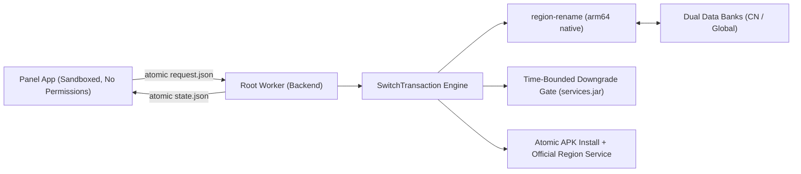

# PICO Region Switch

**Switch PICO's eight regional apps between CN and Global offline, directly on your headset, with separate saved data for each region.**

  
  
  
  

  <strong>English</strong> · <a href="README_zh.md">简体中文</a>

  <a href="#what-it-does">Features</a> ·
  <a href="#requirements">Requirements</a> ·
  <a href="#first-time-installation">Install</a> ·
  <a href="#daily-switching">Daily Use</a> ·
  <a href="#recovery-and-uninstall">Recovery &amp; Uninstall</a> ·
  <a href="#how-it-works">Architecture</a> ·
  <a href="#community">Community</a>

---

## What It Does

One offline Magisk ZIP bundles the on-headset panel (**区域切换**), the background worker, and both regional APK sets. Once installed, switching between CN and Global needs no PC, no internet connection, no separate APK sideloading, and no headset reboot.

| App | Package | Notes |
|---|---|---|
| Matrix | `com.bytedance.pico.matrix` | Social & system matrix service |
| Store | `com.picovr.store` | CN / Global PICO Store |
| User Center | `com.picovr.vrusercenter` | Account & sign-in center |
| Fitness | `com.pvr.pvrfit` | PICO Fitness |
| Friends | `com.picopui.im` | Friends & messaging |
| Home | `com.pvr.home` | Home environment |
| Avatar | `com.pvr.avatareditor` | Avatar editor |
| Swift | `com.pvr.swift` | Motion Tracker / body tracking |

- **Isolated data per region**: CN and Global each keep their own app data in separate banks. One region's apps never read the other region's databases.
- **Your own CN baseline preserved**: Returning to CN restores the exact CN APK versions backed up from your headset on first install rather than overwriting them with someone else's versions.
- **Minimal system footprint**: Switching calls PICO's official regional service without upgrading the OS or modifying base regional properties (`ro.*`), system language, time zone, or the factory country file. Wi-Fi country code follows the official regional service.

## Requirements

Validated on **PICO 4 Pro** running **CN OS 5.13.7** (`v0.6.0`), covering first installation, preparation recovery, first-boot verification, CN/Global round-trips, panel-independent completion, fault rollback, and clean overlay removal.

| Requirement | Details |
|---|---|
| Headset & OS | Rooted **PICO 4 Pro** on **CN OS 5.13.7** |
| Root manager | **Magisk** (installed via the running Magisk app, not recovery; requires Magisk BusyBox) |
| Android user | Primary user (`user 0`) |
| Initial region & apps | Currently on **CN**, with stock OS 5.13.7 or listed CN app updates |
| Free storage | Enough room for the eight backed-up CN APKs plus a full TAR backup of their app data |

> [!NOTE]
> Before touching any app or data, the installer verifies the SHA-256 digests of `/system/framework/services.jar`, the Fitness base APK, and all eight installed CN APKs. Unrecognized baselines abort immediately with no changes made.

## First-Time Installation

1. **Close Virtual Desktop** and save any open work in regional apps.
2. Download `PicoRegionSwitch-<version>.zip` from [Releases](https://github.com/WolalaQAQ/PicoRegionSwitch/releases) and verify its checksum against `SHA256SUMS.txt`.
3. Open **Magisk -> Modules -> Install from storage** and select the ZIP.
4. Wait for the installer to finish. First install backs up your original CN APKs, framework, Fitness base, and a complete app-data TAR, then atomically reinstalls the identical CN APKs as data updates. It does **not** switch regions or move your app data yet.
5. **Reboot once** after Magisk reports success.
6. Open **区域切换** from the headset app library and wait for first-boot verification to complete.
7. Once the panel reports ready, tap **切换到全球区** whenever you want to switch. On first entry into the other region, sign in and set height through the corresponding official PICO service.

> [!CAUTION]
> **If Magisk reports an error during first installation, do NOT reboot** and do NOT delete `/data/adb/pico-region-switch` or any backup directory. Follow [RECOVERY.md](RECOVERY.md#first-install-failed-before-reboot) to roll back the preparation cleanly while the original OS is still running.

## Daily Switching

1. Exit **Virtual Desktop**.
2. Open **区域切换** in your headset app library.
3. Tap **切换到国区** (CN) or **切换到全球区** (Global) and confirm.
4. Wait until the panel shows **切换完成** before launching VR streaming or regional apps.

Regional apps restart during the switch; the headset itself does not reboot. Closing the panel does not interrupt the background worker—reopen **区域切换** at any time to check progress or final status.

## Updating an Existing Installation

1. Make sure no interrupted switch or pending first-boot verification is waiting in the panel.
2. Exit **Virtual Desktop**, install the new `PicoRegionSwitch-<version>.zip` in Magisk, and reboot once.
3. Your current region and both data banks stay intact; first-install initialization does not run again.
4. If you are upgrading from an older 7-app installation, open **区域切换** and tap **完成八组件升级** once to bring Swift into the 8-app dual-bank layout.

## Recovery and Uninstall

> [!WARNING]
> **Never disable or remove the module in Magisk while Global is active.** Always use **准备卸载模块** in the panel first so the headset returns to your full CN setup and clears the Fitness parser cache safely.

| Situation | What to do |
|---|---|
| Switch interrupted or failed | Open **区域切换** and tap **恢复未完成的切换**. Do not delete `headset-pending.json` or any bank directory. |
| First boot still shows verification pending | Open **区域切换** and tap **验证首次安装**. This only reruns verification; it never switches regions or reinstalls. |
| Magisk failed on first install (before reboot) | **Do not reboot.** Follow [First-install failure before reboot](RECOVERY.md#first-install-failed-before-reboot). |
| Headset fails to finish booting | Disable `pico-region-downgrade` and restore preparation; see [Startup rescue](RECOVERY.md#headset-cannot-finish-booting). |
| Normal uninstall | Open **区域切换** -> tap **准备卸载模块** -> wait for completion -> remove the module in Magisk -> reboot. Current CN data, both banks, and recovery archives are preserved. |

For detailed step-by-step commands, see [RECOVERY.md](RECOVERY.md).

---

## How It Works

The panel app (`com.pico4.regionswitch`) runs as a normal sandboxed Android app with zero declared permissions and no network socket. It only writes fixed atomic JSON requests into its own device-protected storage, which the root module worker (`Backend`) polls once per second.

- **Atomic dual-bank swap**: `SwitchTransaction` stops the eight regional apps, snapshots live CE/DE/external data via the strict native `region-rename` helper into the source bank, swaps the target bank into place, calls `PicoRegionServiceCall`, installs the target APKs, and verifies health before clearing `headset-pending.json`. Any failure after data movement triggers a full rollback so neither region's APKs ever run against the other region's databases.
- **Bounded downgrade window**: The patched `services.jar` opens a short time-bounded downgrade window (`sys.pico_region_downgrade_until`) restricted to seven listed packages while keeping official platform signature verification enabled. Swift's CN and Global variants carry matching version codes and do not require downgrade relaxation.

## Development & Building

This repository contains project source code and `config/inputs.lock.json` (SHA-256 identity lock for official inputs)—no PICO binaries or user data are stored in Git.

- **[BUILDING.md](BUILDING.md)** — Local tests, runtime APK/native build, and complete offline Magisk ZIP assembly
- **[RELEASING.md](RELEASING.md)** — GitHub Actions CI, `release` environment secrets, and tag-bound publishing
- **[RECOVERY.md](RECOVERY.md)** — Emergency recovery and startup rescue manual
- **[CHANGELOG.md](CHANGELOG.md)** — Version history

## Pico-Enhance Ecosystem

| Project | Purpose |
|---|---|
| [VD-PicoEnhance](https://github.com/WolalaQAQ/VD-PicoEnhance) | Hand tracking, passthrough, bitrate/resolution unlock, and QoL enhancements for Virtual Desktop on PICO |
| [PicoET-Enhance](https://github.com/WolalaQAQ/PicoET-Enhance) | Real pupil diameter, independent per-eye expressions, 90/90 Hz tracking, on-headset tuning & LAN camera streaming for PICO 4 Pro |
| [PicoFacialBridge](https://github.com/WolalaQAQ/PicoFacialBridge) | Headset-to-PC eye and face tracking bridge for PICO |
| [UnifiedPicoModule](https://github.com/WolalaQAQ/UnifiedPicoModule) | VRCFaceTracking module receiving PICO eye and face tracking on PC |
| [VRCFT-Enhance](https://github.com/WolalaQAQ/VRCFT-Enhance) | Low-latency polling and snapshot consistency patches for VRCFaceTracking |
| **PicoRegionSwitch** *(this repo)* | Offline on-headset CN / Global app switcher with isolated dual-region data banks |
| [PicoUSB-Quiet](https://github.com/WolalaQAQ/PicoUSB-Quiet) | Suppresses PICO OS app-switch prompts and USB confirmation flashes on USB re-attach |

## Community

Join the Pico-Enhance community for help, discussion, and release announcements.

**QQ group:** 1129699813. Scan the code below with QQ to join.

## License

Original source code is licensed under the [MIT License](LICENSE). Official vendor binaries and build dependencies retain their own terms; see [THIRD_PARTY_NOTICES.md](THIRD_PARTY_NOTICES.md).
