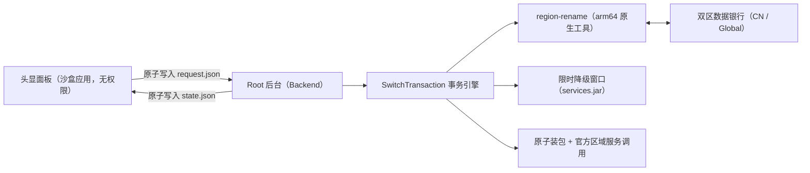

# PICO Region Switch

**在头显内离线切换 PICO 八个国区 / 全球区官方应用，两区数据各自独立保存。**

  
  
  
  

  <a href="README.md">English</a> · <strong>简体中文</strong>

  <a href="#功能简介">功能简介</a> ·
  <a href="#使用要求">使用要求</a> ·
  <a href="#首次安装">首次安装</a> ·
  <a href="#日常切换">日常切换</a> ·
  <a href="#恢复与卸载">恢复与卸载</a> ·
  <a href="#工作原理">工作原理</a> ·
  <a href="#社区">社区</a>

---

## 功能简介

一个离线 Magisk ZIP 同时打包了头显面板（**区域切换**）、后台执行器和两套官方区域 APK。安装完成后，在国区和全球区之间切换不需要电脑、网络、额外装包，也无需重启头显。

| 应用 | 包名 | 说明 |
|---|---|---|
| Matrix | `com.bytedance.pico.matrix` | 社交与系统 Matrix 服务 |
| 商店 | `com.picovr.store` | 国区 / 全球区应用商店 |
| 用户中心 | `com.picovr.vrusercenter` | 账号与登录中心 |
| 运动中心 | `com.pvr.pvrfit` | PICO 运动中心 |
| 好友 | `com.picopui.im` | 好友与消息 |
| Home | `com.pvr.home` | 主界面环境 |
| Avatar | `com.pvr.avatareditor` | 虚拟形象编辑器 |
| Swift 体感 | `com.pvr.swift` | 体感追踪器（腿环 / 腰环） |

- **两区数据完全隔离**：国区和全球区的应用数据存放在各自独立的数据银行中，一区的程序不会读取另一区的数据库。
- **保留本机原国区版本**：切回国区时恢复的是首次安装时从你这台头显备份的原国区 APK，不会强行覆盖成维护者的版本。
- **不改系统底层属性**：通过官方区域服务完成切换，不升级 OS，不改动底层地区属性（`ro.*`）、系统语言、时区或出厂国家文件。Wi-Fi 国家码遵循官方区域服务。

## 使用要求

当前版本 `0.6.0` 已在 **PICO 4 Pro（国区 OS 5.13.7）** 上完成实机验证，覆盖首次安装、准备中断恢复、首次开机验证、两区往返切换、关闭面板后后台完成、故障回滚及撤销映射后正常启动。

| 项目 | 要求 |
|---|---|
| 头显与系统 | 已 root 的 **PICO 4 Pro**，**国区 OS 5.13.7** |
| Root 工具 | **Magisk**（须在开机状态的 Magisk 应用内安装，不能在 Recovery 刷入；依赖 Magisk BusyBox） |
| Android 用户 | 主用户（`user 0`） |
| 初始状态 | 当前处于**国区**，八个应用为固件原装版本或清单中的国区更新版本 |
| 剩余存储空间 | 足以容纳八个原国区 APK 备份及一份完整的应用数据 TAR 归档 |

> [!NOTE]
> 安装器在暂停任何应用或处理数据之前，会逐一核对 `/system/framework/services.jar`、运动中心底包以及八个原国区 APK 的 SHA-256 摘要。若版本不在支持清单内，会直接中止安装，不会改动设备上的应用和数据。

## 首次安装

1. **退出 Virtual Desktop**，保存区域应用中的当前操作。
2. 前往 [Releases](https://github.com/WolalaQAQ/PicoRegionSwitch/releases) 下载 `PicoRegionSwitch-<版本>.zip`，并对照 `SHA256SUMS.txt` 校验文件。
3. 打开 **Magisk -> 模块 -> 从本地安装**，选择该 ZIP。
4. 等待安装完成。首次安装会备份当前国区 APK、原框架、运动中心底包和一份完整应用数据 TAR，并将相同字节的原国区 APK 原子重装为数据更新包。这一步**不会**切区，也**不会**移动应用数据。
5. 安装提示成功后**重启一次头显**。
6. 重启进入系统后，打开应用库中的 **区域切换**，等待首次安装验证完成。
7. 面板显示就绪后即可点击 **切换到全球区**。首次进入另一区域时，按对应官方服务提示登录账号并设置身高。

> [!CAUTION]
> **如果首次安装时 Magisk 报错，先不要重启头显**，也不要手动删除 `/data/adb/pico-region-switch` 或任何备份目录。请按 [RECOVERY_zh.md](RECOVERY_zh.md#首次安装尚未重启时报错) 在原系统运行状态下撤销准备并保留备份。

## 日常切换

1. 退出 **Virtual Desktop**。
2. 在头显应用库中打开 **区域切换**。
3. 点击 **切换到国区** 或 **切换到全球区** 并确认。
4. 等待面板显示 **切换完成** 后再启动串流或打开区域应用。

切换过程中八个区域应用会自动重启，头显本身不需要重启。中途关闭面板不会中断后台任务，随时重新打开 **区域切换** 即可查看进度和结果。

## 更新已有安装

1. 确认面板中没有待恢复的切换任务或待完成的首次安装验证。
2. 退出 **Virtual Desktop**，直接在 Magisk 中安装新版 `PicoRegionSwitch-<版本>.zip` 并重启一次。
3. 已有数据银行和当前所在区域会原样保留，不会重新执行首次安装初始化。
4. 若是从旧版七组件升级而来，更新重启后打开 **区域切换**，点击一次 **完成八组件升级**，将 Swift 体感纳入八组件双区管理。

## 恢复与卸载

> [!WARNING]
> **切勿在当前处于全球区时直接到 Magisk 停用或删除模块。** 正常卸载必须先在面板里完成 **准备卸载模块**，让设备回到完整国区并处理完运动中心解析缓存。

| 遇到什么情况 | 处理方式 |
|---|---|
| 切换中断或失败 | 打开 **区域切换**，点击 **恢复未完成的切换**。不要删除 `headset-pending.json` 或任何银行目录。 |
| 首次重启后显示待验证 | 打开 **区域切换**，点击 **验证首次安装**。该按钮只重新检查启动状态，不会重新安装或自动切区。 |
| 首次安装时 Magisk 报错（尚未重启） | **不要重启。** 按 [首次安装报错恢复](RECOVERY_zh.md#首次安装尚未重启时报错) 执行原安装执行器撤销准备。 |
| 安装模块后无法完成开机 | 停用 `pico-region-downgrade` 模块后恢复准备，详见 [开机救援](RECOVERY_zh.md#头显无法完成开机)。 |
| 正常卸载模块 | 在 **区域切换** 中点击 **准备卸载模块** -> 等待提示完成 -> 在 Magisk 移除模块 -> 重启。当前国区数据、两区银行和备份归档都会保留。 |

完整的排障命令和救援步骤请查看 [RECOVERY_zh.md](RECOVERY_zh.md)。

---

## 工作原理

头显面板（`com.pico4.regionswitch`）是一个普通沙盒应用，不申请任何 Android 权限，也没有网络监听端口。它只向自身设备加密存储目录原子写入固定格式的 JSON 请求，由 Magisk 模块启动的 root 后台（`Backend`）每秒轮询处理。

- **双区数据原子切换**：`SwitchTransaction` 会先停止八个区域应用，通过原生工具 `region-rename` 将当前 CE/DE/外部数据目录存入源区域银行并切入目标区域银行，再调用 `PicoRegionServiceCall` 与原子装包脚本，最后校验健康状态并清理事务日志 `headset-pending.json`。数据移动之后若任何一步失败，都会触发完整回滚，避免一区程序读写另一区的数据库。
- **受限降级窗口**：修补后的 `services.jar` 仅通过属性 `sys.pico_region_downgrade_until` 为七个指定包开放限时降级窗口，官方平台签名校验全程保持开启。Swift 两区 APK 版本码一致，不需要降级放行。

## 开发与构建

本仓库只包含项目源码和官方输入身份清单（`config/inputs.lock.json`），不包含任何 PICO 官方二进制文件或用户数据。

- **[BUILDING_zh.md](BUILDING_zh.md)** — 本地单元测试、运行时 APK/原生构建，以及完整离线 Magisk ZIP 打包
- **[RELEASING_zh.md](RELEASING_zh.md)** — GitHub Actions CI、`release` 环境密钥配置与 Tag 发布流程
- **[RECOVERY_zh.md](RECOVERY_zh.md)** — 紧急恢复与开机救援手册
- **[CHANGELOG_zh.md](CHANGELOG_zh.md)** — 版本更新记录

## Pico-Enhance 生态

| 项目 | 作用 |
|---|---|
| [VD-PicoEnhance](https://github.com/WolalaQAQ/VD-PicoEnhance) | PICO 端 Virtual Desktop 手追、透视、码率与分辨率解锁及多项体验增强 |
| [PicoET-Enhance](https://github.com/WolalaQAQ/PicoET-Enhance) | PICO 4 Pro 真实瞳孔、左右眼独立表情、90/90 Hz 追踪、头显端后处理调节与局域网相机广播 |
| [PicoFacialBridge](https://github.com/WolalaQAQ/PicoFacialBridge) | PICO 头显到 PC 的眼动与面部追踪数据桥接 |
| [UnifiedPicoModule](https://github.com/WolalaQAQ/UnifiedPicoModule) | PC 端接收 PICO 眼追与面捕数据的 VRCFaceTracking 模块 |
| [VRCFT-Enhance](https://github.com/WolalaQAQ/VRCFT-Enhance) | VRCFaceTracking 低延迟轮询与完整快照一致性补丁 |
| **PicoRegionSwitch**（本仓库） | PICO 头显离线国区 / 全球区应用切换与双区数据隔离 |
| [PicoUSB-Quiet](https://github.com/WolalaQAQ/PicoUSB-Quiet) | 消除 PICO 扩展坞 USB 重连时的退出应用弹窗与确认框闪烁 |

## 社区

使用求助、交流和版本更新通知，欢迎加入 Pico-Enhance 社区。

**QQ 群：** 1129699813，用 QQ 扫描下方二维码即可加入。

## 许可证

仓库自有源码采用 [MIT 许可证](LICENSE)。官方程序及构建依赖遵循各自许可，详见 [THIRD_PARTY_NOTICES.md](THIRD_PARTY_NOTICES.md)。
